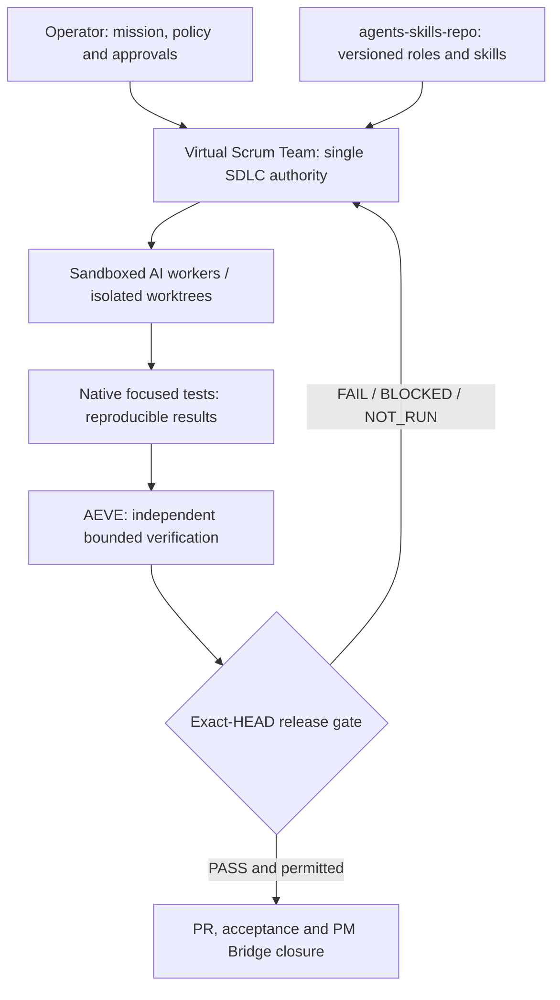

# Unified Virtual Engineering Organization — Master Blueprint (Draft 1, amended after review, see section 13)

**Date:** 2026-10-23  
**Owner:** project operator  
**Status:** PROPOSED ARCHITECTURE / READ-ONLY INVENTORY; NOT DEPLOYED, NOT ACCEPTED  
**Source policy:** All durable Git documents in English. This proposal contains organizational inventory only; do not add product-private specifications, PII, secrets or customer data.  
**Mission:** One automated but controlled engineering organization from idea to sprint acceptance: analysis, design, code, testing, security, review, delivery and retrospectives.

## 1. Executive decision

Build **one SDLC control plane** around the existing `Virtual_scrum_team`. Do not replace it with MetaGPT, BMad, OpenHands or AEVE. Treat the other projects as independent layers with sharply separated state ownership:

1. **Virtual Scrum Team** — canonical ten-phase workflow, assignments, DoR/DoD, decisions, operator approvals and project-specific `docs/sdlc/STATE.md`.
2. **agents-skills-repo** — versioned, reusable definitions of specialist roles and focused skills; published/installable copies are a separate inventory.
3. **Execution adapters** — isolated worktrees and bounded AI code workers. Pilot BMad Loop; selectively compare OpenHands or Aider. The execution tool does not approve its own output.
4. **Native CI and test runners** — actual test execution, environments, exit codes and artifacts. Do not confuse a test-writing prompt with a working runner.
5. **AEVE** — bounded source inspection, specialized deterministic analysis, profile routing and provenance/evidence verification; independent quality evidence, not a general programming/runtime replacement.
6. **Personal DC v2.2** — limited Windows access bridge; authorize only exposed operations, not fictional arbitrary command execution.
7. **PM Bridge** — sprint closure reporting/integration **only after acceptance**, not daily task assignment or primary SDLC state.

Autonomy goal: an operator defines the mission and permitted scope; approved workers perform bounded tasks and produce a reviewable release candidate. **No unapproved destructive edits, production changes, external AI reviews, provider calls, financial actions, merges or release publication.** Fully automated *engineering work* does not mean unlimited authority.

## 2. Inventory and ownership

Sources below were cross-checked against prior discussions; directory existence and main READMEs were observed through a local access bridge on 2026-10-23 (unreproducible from this repository and not bound to any Git HEAD). Exact Git HEADs are historical unless separately marked. `${WORKSPACE_REPOS}` means the operator-configured local repository root; `${TEMP_SNAPSHOTS}` means an operator-configured benchmark directory. Private absolute mappings stay outside this generic repository.

| Local location | Repository / identity | Role and decision | Verification limits |
|---|---|---|---|
| `${WORKSPACE_REPOS}\Virtual_scrum_team` | Local virtual scrum team; Git remote to revalidate | **KEEP: SDLC source of truth.** Ten phases, 6 directly authored agent profiles and 7 orchestration/team skills. Contains `docs/FULL_TEAM_EXPANSION_PLAN_2026-10-23.md`, existing 39-role **proposal**. | Catalog source != installed/routed agents. Proposal is not accepted. |
| `${WORKSPACE_REPOS}\agents-skills-repo` | `https://github.com/xLZDx/Usefull_agents_and_skils` | **KEEP: reusable specialist registry.** Historical inventory: 36 agents, 8 qualifying tracked skills. | Inventory, licenses and installed divergence must be re-audited. Never overwrite local modifications. |
| `${WORKSPACE_REPOS}\.claude\agents`, `${WORKSPACE_REPOS}\.claude\skills`, `${WORKSPACE_REPOS}\AGENTS.md` | Local installed Claude/global policy | **KEEP: runtime installation targets**, not editable source of truth. | Profiles may diverge; resolve model frontmatter and exact content hash. |
| `${WORKSPACE_REPOS}\AEVE` | private repository (URL withheld from this public document) | **KEEP: independent bounded evidence engine**, profile catalog, analyzer and task ledger. | Current README says 28 roles + 29 skills; 15/57 have **some** deterministic executor mapping, 42/57 not covered; mapped 15 only PARTIAL. Not 57 executable agents. |
| `${TEMP_SNAPSHOTS}\AEVE-clean-runtime-6787c8db` | Snapshot registered as `AEVE` in Personal DC project listing | **KEEP: frozen benchmark**, not primary working checkout. | Critical misbinding: Personal DC `AEVE` points here, while actual development is `${WORKSPACE_REPOS}\AEVE`. Fix project registry later under approval; do not overwrite snapshot. |
| `${WORKSPACE_REPOS}\MegaGpt\MetaGPT` | `https://github.com/FoundationAgents/MetaGPT` | **REFERENCE ONLY** for structured handoffs, role SOP, dependency ordering, budget controls. | Local environment and compatibility vary; no blind code execution or auto-install. |
| Aider, no verified local checkout | `https://github.com/Aider-AI/aider` | **PILOT** repository map and architect/editor change flow. | Disable uncontrolled auto-commit; isolate worktree; respect supported Python/LLM API. |
| `${WORKSPACE_REPOS}\Personal_DC` | Personal DC v2.2 Showcase gateway | **KEEP: bounded transport.** Health and directory reads succeed after restart. | Current discovered tool boundary has no arbitrary shell execution; health reports deletion tool not exposed. |
| `${WORKSPACE_REPOS}\pm-bridge` | private repository (URL withheld from this public document) | **KEEP: sprint closure only.** | No competing state writer. |
| `${WORKSPACE_REPOS}\Fitness_App`, worktrees | `https://github.com/xLZDx/Fitness-App` | PILOT: Flutter/mobile + Firebase, offline queues, auth and rules. | Existing active worktrees and user changes must be preserved. |
| `${WORKSPACE_REPOS}\Personal_Decision_Command_Center` | private repository (URL withheld from this public document) | PILOT: multi-tenant PWA, source connections, auth, audit. | Read-only until the sandbox is qualified. |
| `${WORKSPACE_REPOS}\ERP`, `${WORKSPACE_REPOS}\ERP_UNIFIED_WORKTREE` | private repository (URL withheld from this public document) | LATER PILOT: multi-module ERP, SQL/transactions, migrations. | No automatic schema/prod migration. |
| `${WORKSPACE_REPOS}\ERP_MCP` / historical `${WORKSPACE_REPOS}\ERP_MCP_R2` | `https://github.com/xLZDx/ERP_MCP` | LATER PILOT: 1C read-only gateway, SQL fencing/recovery. **Distinct from ERP.** | Native 1C reconciliation remains NOT_RUN without genuine reports; educational 1C COM forbidden. |
| `${WORKSPACE_REPOS}\AI_trading_assistance` | Local registered project | Future optional ML/quant specialist consumer. | Financial and external execution require separate authority. |

Personal DC listing currently registers `Personal_DC`, `ERP_MCP`, `PDCC`, `AI_Trading`, `Fitness_App`, `PM_Bridge`, `AEVE` (to frozen temp snapshot), and an absent `ERP_MCP_ChatGPT`. It **does not** automatically cover every `${WORKSPACE_REPOS}` directory. Discovery by direct path works, but an explicit registry reconciliation is needed.

## 3. System boundaries and source of truth



Enforce **one writer per domain**:

- Scrum workflow and story states: Virtual Scrum Team (per-project `docs/sdlc/STATE.md`).
- Global role/skill source: agents-skills-repo; team-specific workflow roles in Virtual Scrum Team, with a manifest referencing source hashes rather than silent duplication.
- Branch files: single implementation worker per worktree. Other reviewers see immutable snapshots.
- Runner result: native test process only. Agent summaries cannot set `PASSED` by fiat.
- Analyzer result: AEVE only for the deterministic check **it actually executed**.
- Release acceptance: designated independent gate/operator. PM Bridge receives an accepted immutable record; it does not reopen or rewrite testing outcomes.

## 4. Workflow and execution rules

The current `Virtual_scrum_team/docs/SDLC_PROCESS.md` prescribes these **ten phases**. We retain the sequence and explicit exit artifacts:

| Phase | Outcome | Primary owner | Hard gate |
|---|---|---|---|
| 1. Discovery | Requirements and risks | Business analyst | Scope, assumptions, safety constraints |
| 2. Backlog | Epics, stories, DoR/DoD | Product owner | Acceptance criteria, dependencies |
| 3. Design | ADRs, interface/UI/data specs | Architect + designer | Independent architecture/security check where risk requires |
| 4. Docs & test plan | TDD, test matrix, failure oracle | Tech writer + authorized test agents | Testability and negative cases |
| 5. Doc review | Reviewed design baseline | Risk-scoped reviewer, GPT-PM | Findings adjudicated |
| 6. Build | Bounded branch/worktree changes | Implementation engineer | Code committed to candidate HEAD |
| 7. Verify | Native functional, integration, E2E and risk-specific tests | Authorized test writers/runners | Exact-head evidence and independent review |
| 8. Gate | Go/no-go decision, approved PR | GPT-PM / designated acceptance owner | All required evidence current and valid |
| 9. Accept & release | Accepted deliverable and release docs | Product owner / release owner | Operator-reserved release actions preserved |
| 10. Report & retro | Metrics, retro, sprint closure | Reporting analyst (PM Bridge only consumes the accepted closure afterwards) | No state rewritten after signed closure |

**Important existing rule:** the live workflow forbids tests/checks during the implementation phase and restricts test authoring/execution to `functional-test-reviewer` and `e2e-runner`. The roster previously described `tdd-guide` as a test author; ADR-0001 (2026-10-24) settled this: only those two agents author and run required tests, `tdd-guide` is advisory, and no red-green loop is authorized. Tests may be *planned* in phase 4 and executed in phase 7 under the present contract.

**Policy drift discovered during direct source verification:** `${WORKSPACE_REPOS}\AGENTS.md` currently specifies `gpt-6-luna` for ordinary reviewer/test-agent runs (low/medium; optional operator-selected `gpt-5.6-luna` only for consensus); the repository-local `AGENTS.md` sets only the `sonnet` alias and has no Luna text, while `README.md`, `docs/SDLC_PROCESS.md` and `sdlc-orchestrator/SKILL.md` describe Sonnet 5.5 medium or GPT-5.6 Luna low/medium, as does the operator's global contract. Three sources disagree (section 13, C-1); the drift concerns reviewer and test roles only. The **current workspace-level source must be reconciled** before any role launch. Do not interpret historical Sonnet conventions as current authorization or silently modify a working global profile. The orchestrator also explicitly forbids full-suite, lint, typecheck, build and CI in phase 7: ADR-0001 (2026-10-24) confirms that no CI is authorized; any CI mention in this blueprint is an inactive future capability, not a permitted action.

## 5. 39-role staffing plan (logical competencies, not simultaneous processes)

Roles are capability IDs, each resolving to one source profile, permissions, skills, runtime and qualification evidence. A role must be `QUALIFIED`, `PARTIAL` or `UNAVAILABLE`; a file on disk is not enough.

### Product / Scrum (6)
1. Business analyst; 2. Product manager / PRD owner; 3. Product owner / backlog owner; 4. Scrum master / SDLC orchestrator; 5. Sprint planner / estimator; 6. UX researcher.

### Architecture / Design (6)
7. System architect; 8. Code/feature architect; 9. Data architect; 10. Security/trust architect; 11. UI/interaction designer; 12. Accessibility specialist.

### Engineering (8)
13. Engineering lead; 14. Python/backend engineer; 15. Frontend/PWA engineer; 16. Flutter/mobile engineer; 17. API/integration engineer; 18. Data/migration engineer; 19. ML/AI engineer; 20. Build/refactoring engineer.

### Quality Engineering (12)
21. QA/test architect; 22. Functional/unit/property specialist; 23. Web E2E specialist; 24. Mobile E2E specialist; 25. API/contract specialist; 26. Integration specialist; 27. Regression/mutation specialist; 28. Performance/load specialist; 29. Security testing specialist; 30. Database integrity specialist; 31. Network/chaos specialist; 32. Independent test-evidence auditor.

### Operations / Governance (7)
33. CI/CD engineer (inactive while no CI is authorized, ADR-0001); 34. SRE/observability engineer; 35. Release manager; 36. Technical writer; 37. Reporting analyst; 38. Recovery/concurrency reviewer; 39. Privacy/compliance reviewer.

**Operational staffing:** Start with **5 concurrent AI worker slots + 5 CI runners maximum** (the CI limit is inactive: ADR-0001 authorizes no CI), not 39 LLM sessions. Per task use one primary role plus necessary skill overlays, and independent reviewers only for actual risks. Never let an implementer approve its own commit; never let the same evaluator fabricate a runner receipt. The **live workspace-level policy** presently prescribes `gpt-6-luna` (low/medium) for ordinary reviewer and test agent runs, with a narrow GPT-5.6 Luna consensus exception. VST's local Sonnet-5.5 documentation and historical Opus-selecting `architect`/`planner` profiles conflict with this; resolve via an explicit model mapping and policy edit before routing. Opus is not automatic. Do not replace installed Claude/Codex agents or invoke external reviewers without authorization.

**Priority additions:** `qa-test-architect`, `test-evidence-auditor`, `api-contract-test-specialist`, `mobile-test-specialist`, `integration-test-specialist`, `security-architect`, `ci-cd-engineer`, `sre-observability-engineer`, `recovery-concurrency-reviewer`. Keep other low-frequency skills as overlays, not new resident workers.

## 6. Borrow vs build: external GitHub catalog

| Candidate | Decision | What to reuse | Red line / validation |
|---|---|---|---|
| [BMad Method](https://github.com/bmad-code-org/BMAD-METHOD) | **ADOPT selectively** | Agile role SOP, risk/requirements and story templates | Do not create second canonical Scrum board |
| [BMad Loop](https://github.com/bmad-code-org/bmad-loop) | **TOP execution pilot** | Isolated worktrees, story loop, independent review, bounded retry, budget and resume | Verify the current code, license, Windows/WSL2 compatibility, storage and approvals before activation |
| [BMad TEA](https://github.com/bmad-code-org/bmad-method-test-architecture-enterprise) | **TOP QA skills pilot** | Risk-driven plans, test quality checks, NFR reviews, requirements-to-test trace and explicit release evidence | Current TEA workflows have stack-dependent execution; map into existing test-authority policy |
| [GitHub Spec Kit](https://github.com/github/spec-kit) | **ADOPT templates** | `specify`/`plan`/`tasks` artifact discipline | One canonical phase owner; avoid duplicated task state |
| [MetaGPT](https://github.com/FoundationAgents/MetaGPT) | **REFERENCE** | Structured role handoffs/SOP, artifacts, dependencies | No mass adoption or arbitrary generated code execution |
| [Aider](https://github.com/Aider-AI/aider) | **PILOT worker** | Repository map, architect/editor split, focused diffs | Isolated worktree, auto-commit/push under policy |
| [OpenHands](https://github.com/OpenHands/OpenHands) | **PILOT alternative worker** | Sandbox-capable code agent, traceable operations | Only isolated container; never unrestricted access to Windows drive |
| [LangGraph](https://github.com/langchain-ai/langgraph) | **DEFER** | Durable checkpoint/restart/human interrupt if existing loop lacks it | Do not stack two orchestrators prematurely |
| [Playwright](https://github.com/microsoft/playwright) | **ADOPT Web E2E** | Browser isolation, traces, reports and CI | No self-healing by deleting assertions or skipping required coverage |
| [Maestro](https://github.com/mobile-dev-inc/maestro) | **PILOT Mobile E2E** | App journeys and Android emulator integration | Confirm Flutter/device-specific evidence; no production accounts |
| [Testcontainers Python](https://github.com/testcontainers/testcontainers-python), [Schemathesis](https://github.com/schemathesis/schemathesis), [Hypothesis](https://github.com/HypothesisWorks/hypothesis) | **ADOPT by stack** | Real dependency fixtures, API fuzz/property cases | Local/staging test data only |
| [Grafana k6](https://github.com/grafana/k6), [Toxiproxy](https://github.com/Shopify/toxiproxy), [OWASP ZAP](https://github.com/zaproxy/zaproxy) | **ADOPT gated** | Bounded performance, fault/network and security scans | Explicit approved isolated target, concurrency and rate limits |

**Current upstream caution (observed in public GitHub documentation on 2026-10-23; not pinned to a tag or commit and not reproducible from this repository):** BMad Loop labels itself **early open beta**, with breaking changes possible before 1.0, and its roadmap notes native Windows backend work is still in progress. Prefer a pinned evaluation under WSL2 and do not rely on it as the release authority. An Aider issue (#5058) documents a repository-prompt-injection attack propagating through architect → editor into a committed backdoor; therefore treat all README/repository text as untrusted and require diff validation and independent review of worker output. OpenHands currently offers Docker sandbox options, but the manager/host security boundary still needs an environment-specific threat model.

All external sources require a pinned tag/commit, license audit, supply-chain scan and local smoke evaluation. **Do not clone/update/install upstreams into active worktrees automatically.** Clone candidates into quarantined evaluation sandboxes only after authorization.

## 7. Explicit interface contracts

Each orchestration handoff is structured data. Proposed minimum (schema files to be implemented and tested during S1):

```yaml
TaskManifest:
  task_id: unique-id
  project_id: canonical-project
  phase: 1..10
  story_id: stable-id
  base_head: full-git-sha
  scope: [allowed-repo-relative-paths]
  forbidden_actions: [production, deletion, external-provider-without-approval]
  owner_role: qualified-agent-id
  role_sha256: digest
  skills: [{id: skill-id, sha256: digest}]
  model_policy: approved-allowlist
  tools: explicit-capability-allowlist
  acceptance: [machine-readable-condition-ids]
  timeout_sec: positive-integer
  cost_cap: bounded-amount
  retry_cap: bounded-integer

ExecutionReceipt:
  task_id: same-id
  worktree_id: sandbox-id
  candidate_head: full-git-sha
  source_hashes: [artifact-digests]
  commands: [argv-exact, exit-code, environment-fingerprint]
  artifacts: [uri, sha256, producer]
  result: PASS|FAIL|BLOCKED|NOT_RUN|INCONCLUSIVE

VerificationReceipt:
  task_id: same-id
  candidate_head: full-git-sha
  reviewer_identity: independent-identity
  source_digest: digest
  covered_rules: [bounded-contract-ids]
  unsupported_rules: [contract-ids]
  findings: [id, severity, reproduction, evidence]
  status: PASS|FAIL|BLOCKED|NOT_RUN|INCONCLUSIVE

GateDecision:
  task_id: same-id
  candidate_head: full-git-sha
  required_receipt_hashes: [sha256]
  unresolved_findings: [id]
  human_approvals: [scope-specific-approval-id]
  verdict: APPROVE|APPROVED_WITH_WAIVER|MODIFY|NO_GO
  waiver_record: operator-record-id-or-null  # required if and only if verdict is APPROVED_WITH_WAIVER (ADR-0001)
```

No orphan receipts, path traversal, stale HEAD, absent model authorization, missing tester independence or unbound hashes. A new candidate HEAD invalidates all prior source-bound approvals unless an explicit scoped requalification proves otherwise. `NOT_RUN` must never be converted into `PASS`. `NO_FINDINGS` from a limited analyzer must never be marketed as a full security or code-review PASS.

## 8. Runners and test matrix

| Risk / layer | Native runner | Positive + adversarial evidence required |
|---|---|---|
| Unit/functional/property | pytest, project-native Flutter/JS tests, Hypothesis | Known-defect fixtures on synthetic repositories; boundary cases; deterministic fixtures (no red/green and no mutation runs, ADR-0001) |
| API/contract | Schemathesis + schema validation | Tenant/auth negative tests, error paths, pagination, version/serialization failures |
| Integration | Testcontainers, emulator fixtures | DB transactions, outbox/idempotency, service boundaries, timeouts and rollback |
| Web E2E | Playwright | Critical journeys, traces, network failures, logout and multi-tenant isolation |
| Android E2E | Maestro + Android emulator/device | Resume/offline, permission changes, account transitions, accessibility |
| Regression / mutation | Native focused suites run by the two test agents; mutation tools are NOT_RUN by operator decision (ADR-0001) | No silent skipped assertions; every expected test id executed |
| Performance | k6 | Pre-approved SLOs, p95/p99, error rate, bounded isolated target |
| Security / supply chain | ZAP, Semgrep/Trivy as applicable | AuthZ/tenant/RLS, secret scans, dependency evidence; scope authorization |
| Database | pgTAP / SQLite harness / DB-native migration verifier | Isolation, constraints, locks, concurrent writer fencing, forward/backward migration |
| Network / resilience | Toxiproxy + local fault harness | Packet loss, delayed response, restart/crash, retry/idempotency/recovery |

Project overlays:

- **FitnessUp:** Flutter build/unit/golden/UI plus Maestro, Firebase emulator negative security rules, background/foreground transitions, per-user local queue and logout.
- **PDCC:** multi-tenant auth/permissions, source connection state-machine, service-worker/PWA regressions, Playwright browser sessions, replay/idempotency and API/DB fencing.
- **ERP:** module contract/financial invariants, transactional and migration consistency; no automatic real ledgers or production DB writes.
- **ERP_MCP:** private-writer/SQL fence, epoch/recovery, read-only 1C boundary; real native 1C report reconciliation stays `NOT_RUN` without supplied evidence.
- **AEVE:** static analyzer seeded false-negative/false-positive corpus, profile-hash and permission-denial fixtures, exception-flight/branch tests, crash/resume/STOP tests. Strictly label unimplemented route coverage.

## 9. Permissions, safety and failure handling

1. Default read-only for unfamiliar project/repo; writable worktree capability only after explicit task grant.
2. Workers must be sandboxed with isolated credentials, network policy, CPU/RAM/time budgets. On Windows prefer dedicated WSL2/Docker executor, **never** an unrestricted agent on a user drive.
3. Separate test staging from real services; security scans, load and network fault injection always limited to approved targets.
4. For every retry record cause, candidate SHA, budget and previous failure. Non-idempotent operations need an idempotency key; no infinite self-correction.
5. Handle process death, machine restart, timeout, cancelled run, duplicate queue item, stale worker and forced STOP; guarantee at most one authoritative acceptance writer.
6. On AI/provider outage route to manual decision path. No silent model/provider fallback that violates approval, privacy or model rules.
7. Preserve dirty worktrees; never wholesale `reset`, wipe, install, migration apply, push, merge or production rollout without matching operator authority.
8. Operator-stated initial limit (no source file, no enforcer yet, see section 13 R-6): up to 5 concurrent AI agents (the 5 CI workers are inactive: no CI is authorized, ADR-0001); independent reviewers only as needed; retain the 13 security/release gates where applicable (the list of 13 is NOT defined in this repository; define it or drop the number before S9).
9. Records written to Git in English. Public generic catalogs exclude personal paths, PII, provider tokens and project-specific secrets.

## 10. Roadmap with measurable exits

| Sprint | Scope | Exit artifact / go-no-go |
|---|---|---|
| **S0: Ground truth** | Git HEAD/dirty inventory of every repo and installed profile; resolve Personal DC AEVE misbinding, model-policy drift and test-runner-scope conflicts; capability/risk/license matrix | `REPO_REGISTRY`, `PROFILE_RESOLUTION`, `TOOLS_CAPABILITY_MATRIX`; 0 silently overwritten files |
| **S1: Contracts** | Source hash, role + skill manifests, permission matrix, states and schema validators | Negative schema tests pass; mismatched HEAD and `NOT_RUN` cannot pass |
| **S2: Planning router** | Risk map → smallest qualified role/skill set; ten-phase artifacts; model policy | 39 roles classified `QUALIFIED/PARTIAL/UNAVAILABLE`; unresolved aliases block execution |
| **S3: Worker pilot** | Single isolated BMad Loop story adapter; compare OpenHands/Aider only on controlled fixtures | Crash/STOP/retry/budget/worktree tests; no unauthorized write |
| **S4: QA automation** | Wire real native runners for functional, integration, API, E2E, regression and seeded failures | Tests run with reproducible artifacts; skipped test cannot satisfy DoD |
| **S5: AEVE gate** | Bounded static review + hashes, independent evidence/coverage receipt | Analyzer supported/unsupported status truthful; stale HEAD fails |
| **S6: CI/PR** | Exact-head focused-test evidence from the two test agents (no CI, ADR-0001), English PRs, one PR/sprint, manual release approval; PM Bridge closure | No publication without matching authority and receipt set |
| **S7: Reliability** | Race, worker expiry, network outage, manual fallback, observability, cost controls | Restart/rollback/STOP drills pass and audit log complete |
| **S8: End-to-end pilot** | First synthetic sprint, then approved FitnessUp sprint; PDCC security regression separately | Full ten phases and independent acceptance, without production side effects |
| **S9: Scale** | Add broader ERP/ERP_MCP adapters; expand concurrency only after evidence | 13 required gates PASS where applicable; exact-head focused functional+E2E evidence (no CI, ADR-0001); rollback/runbook; only designated manual acceptance remains |

Recommended implementation order: **S0 → S1 → S2 → S3 → S4 → S5 → S6 → S7 → S8 → S9**. Parallelize independent *verification* work within permitted bounds, but retain one authoritative state machine.

## 11. Definition of Done for the organization

It is only fair to call the engineering organization **operational** if:

- One approved story has moved through all ten phases end-to-end, twice, including an intentional failure/repair round and unexpected worker death.
- Every invoked role, skill and tool resolves to a versioned, authorized, proven working artifact (not just a profile filename).
- Tests genuinely ran on the exact candidate HEAD, their commands and outputs are persisted and their negative oracles exercised.
- Independent reviewer was not the author of the change; AEVE only attests to bounded checks it actually performed.
- Unauthorized actions, stale HEAD, missing receipts, offline 1C reports, model-policy violations and `NOT_RUN` all block the gate.
- STOP/rollback/restart isolation and idempotent resumption pass under a deliberately injected failure.
- The operator can inspect a single state board and approve/deny release; PM Bridge only closes accepted sprint.
- Cost, context and tool budgets are measurable and limited; privacy scope is respected.
- No customer/prod data is modified as a consequence of agent testing.

## 12. Work to do now (safe next slice)

1. Read-only S0 scan via Personal DC: `git status`, origin URLs and exact HEADs for `Virtual_scrum_team`, `agents-skills-repo`, `AEVE`, `MetaGPT`, `pm-bridge` and selected pilot; list global installs. Avoid activating clones or installing dependencies.
2. Review and reconcile existing `Virtual_scrum_team/docs/FULL_TEAM_EXPANSION_PLAN_2026-10-23.md` (already present and proposal-only). Do not duplicate/conflict with it when implementing approved design.
3. Correct the **Personal DC AEVE project ID mapping** by a separate scoped configuration change: current alias points to `${TEMP_SNAPSHOTS}\AEVE-clean-runtime-6787c8db`, while development checkout is `${WORKSPACE_REPOS}\AEVE`. Preserve frozen snapshot and historical evidence.
4. Close VST-007 retained evidence and VST-008 exact-head gating, the `tdd-guide` conflict is settled by ADR-0001 (advisory only).
5. Produce an operator-reviewed S1 ticket set before any agent installation, code execution or repository mutation.

**Current readiness:** Discovery/architecture drafted; read-only directory checks passed (unreproducible observation); 39 logical role *proposal* exists; AEVE bounded implementation exists; integrated worker and QA end-to-end process is **NOT DEMONSTRATED**. Final organization verdict: **DESIGN PROPOSED, MODIFY after the 2026-10-23 devil's-advocate review (section 13); RUNTIME / PRODUCTION NO-GO until S0–S8 evidence**.

## 13. Review disposition (devil's-advocate review, 2026-10-23)

Six read-only reviewer agents (architecture, security, reliability, test strategy, silent-failure, consistency; Sonnet 5.5, medium effort) reviewed this blueprint, the provenance dossier and the expansion plan. All six returned **MODIFY DESIGN**. The findings are reviewer claims; items marked VERIFIED were re-checked by the coordinator against repository files. This section amends the blueprint: where it conflicts with sections 1-12, this section wins. Nothing here is implemented or accepted.

### 13.1 Kept
Virtual Scrum Team as the single SDLC authority; workers that never approve their own output; PM Bridge only at sprint closure; `NOT_RUN` never becomes `PASS`; operator-only irreversible actions.

### 13.2 Required before S3 (worker pilot) starts

| ID | Requirement | Acceptance test |
|---|---|---|
| R-1 | Receipts are written by a runner outside the worker's trust domain, signed, kept in an append-only store outside the worker's mount. `result` is computed by the harness (typed success conditions per receipt type: test run - collected ids equal expected ids, none skipped, every exit code 0; static analysis - coverage status; review - signed verdict; documentation task - its stated check). `reviewer_identity` is a verifiable principal, not a string | A forged PASS, a receipt replayed after a new commit, and an artifact edited after hashing are all rejected |
| R-2 | The gate has a total verdict function: the gate, not the decision author, derives the required (role, kind) receipt slots from the manifest; APPROVE only if every acceptance id is covered and no unsupported rule intersects acceptance; a coverage status PARTIAL exists and never satisfies a required id; a receipt for the task that is not listed is a fault | Acceptance {A,B} with a receipt covering {A} is not APPROVE; a deleted required receipt gives NO_GO |
| R-3 | A durable state store with compare-and-swap epoch fencing (for example SQLite in WAL mode, or an append-only log under an exclusive lock); `docs/sdlc/STATE.md` becomes a generated view; manifest and receipts carry `attempt_id`, `fence_epoch`, `lease_expiry` | Two orchestrators on one story: exactly one holds the epoch; a zombie's late receipt is rejected |
| R-4 | Receipts are append-only with an attempt number and a previous-receipt hash; a supervisor writes `INCONCLUSIVE(WORKER_LOST)` when a lease expires without a receipt and `BLOCKED(RETRY_EXHAUSTED)` at the retry cap; a failed attempt stays visible after a later PASS | Worker killed after commit and before receipt blocks the gate; FAIL followed by PASS keeps the FAIL readable |
| R-5 | One ADR settles C-02 (test order), C-03 (who owns verification, and whether any CI is allowed outside phase 7) and the new C-13 (falsifiability without mutation runs). ADR-0001 (2026-10-24) records the operator decisions (two test authors, no CI, no mutation runs, NOT_RUN waiver verdict); enforcement in code does not exist yet. Accordingly the red/green, mutation and seeded-bug clauses in section 8 and the CI wording in the S6 and S9 exits are suspended and read as `NOT_RUN` | Every mention of mutation, red/green, seeded defect or CI in the documents cites an ADR id or `NOT_RUN` |
| R-6 | The initial 5 AI + 5 CI limit and every cost cap are enforced by infrastructure (a slot table taken in the same transaction as the lease, a metered budget ledger with a kill action), not by manifest fields. Unattended mode stays off until the kill path is proven | 20 queued items never exceed 5 running; a worker with a tiny cap is killed and recorded as `BLOCKED(budget)` |

### 13.3 Roadmap amendments
- S0 exit additionally requires the ADRs in R-5 and the model-policy precedence decision (C-1 below).
- The state store, fencing fields and event log move from S7 into S1; the STOP and kill-injection harness is built before S3.
- Replace "S0-S2 breadth first" with a thin vertical slice: one synthetic story, one worktree, one worker (a hand-written loop is acceptable), one native test run that emits a signed receipt, one stale-HEAD rejection, one worker-death recovery.
- S3 compares BMad Loop, a hand-written loop and one durable engine on the same crash/resume fixture before any "TOP" choice; the worker interface stays vendor-neutral. The label "TOP execution pilot" in section 6 is provisional.
- Every S0-S9 exit and the Definition of Done must name its acceptance mechanism class (executable negative test, schema validation, signed inventory, static audit, independently reviewed proof, or explicit operator decision), a non-empty denominator, and for executable checks a failing input that must be rejected; "where applicable" needs a recorded per-project applicability table; the DoD becomes drills D1..Dn on a synthetic repository with a local bare remote.
- AEVE is an optional receipt in v1; it becomes required only for rule ids with seeded-defect evidence.

### 13.4 Other required specifications
Sandbox (dedicated distro or VM with automount and interop disabled, no container-engine socket, default-deny egress, non-root, per-run scoped secrets, pre-flight probe); deterministic diff gate before any model review (path allowlist from scope; block edits to CI configuration, lockfiles, hooks, manifests, install scripts); read-only separately credentialed reviewer with a signed verdict; worker and CI credential model (no push token, least-privilege CI permissions); threat model for the local access bridge (authentication, path allowlist, audit); commit-SHA pinning with hash-locked dependencies for every upstream; synthetic-data and redaction rules for pilot projects; STOP and rollback transition table; idempotency keys for push, pull request and receipts; circuit breaker with a paused-provider state; startup reconciliation after restart; hash-chained event log; authority class per QA role (only `functional-test-reviewer` and `e2e-runner` author and run tests unless an ADR changes that); a `ManualOverrideReceipt` so a manual fallback is never recorded as a plain APPROVE; role hash, resolved model and invocation id echoed in receipts.

### 13.5 Consistency corrections
- C-1 (RESOLVED for this repository in ADR-0001: the operator's global contract wins; the workspace `AGENTS.md` still needs a correction outside this repository) Model policy has three sources: workspace `AGENTS.md` (GPT-6 Luna for reviewer and test agents), the operator's global contract and this repository's `README.md` / `docs/SDLC_PROCESS.md` (Sonnet 5.5 medium or GPT-5.6 Luna low/medium). This repository's `AGENTS.md` sets only the `sonnet` alias. Precedence is decided by ADR-0001 for this repository (VERIFIED); the workspace `AGENTS.md` correction remains open and, until done, a role launch must follow the operator's global contract.
- C-2 The earlier "DESIGN GO" verdict is withdrawn (VERIFIED against the status line).
- C-3 The list of "13 security/release gates", the origin of the 5+5 limit and the mapping between S0-S9 here and P0-P4 in the expansion plan are undefined; PM Bridge as a phase-10 owner changes `docs/SDLC_PROCESS.md` and is a proposed change.
- C-4 Statements of the form "verified" or "checked via" the local bridge or GitHub are unreproducible observations.
- C-5 Personal name, location and one private path were removed from tracked files. Private repository names and URLs in section 2 remain and need an operator decision (O-1 below).

### 13.6 Open operator decisions
- O-1 Keep the inventory of private repositories and the local bridge topology (sections 2 and 12) in this public repository, generalize it, or move it to a private location.
- O-2 (RESOLVED 2026-10-24, ADR-0001: two agents only) Whether more than two agents may author and run tests (a policy change, not a roster change).
- O-3 (RESOLVED 2026-10-24, ADR-0001: no CI) Whether any CI (outside phase 7) is allowed at all, given the operator's existing rule not to read or wait for CI.
